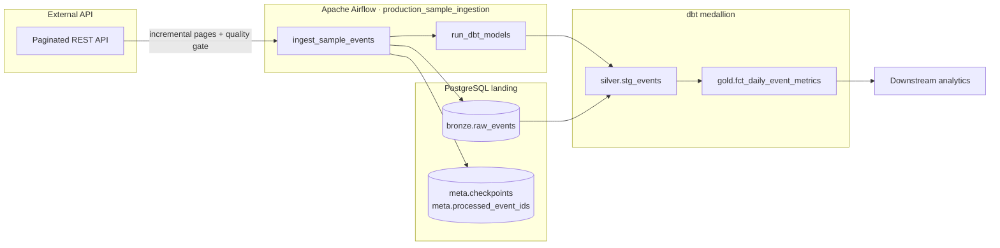

# Production-Grade Incremental Data Pipeline | Python, PostgreSQL, dbt, Apache Airflow

> **Incremental ETL pipeline** for API ingestion with checkpointing, PostgreSQL bronze landing, dbt transformations, and Apache Airflow orchestration — a reference implementation for data engineers building reliable cloud data platforms.

A production-style **data engineering** portfolio project demonstrating incremental API ingestion, idempotent loads, medallion-style layering (bronze → silver → gold), and operational monitoring — patterns used in modern **ETL/ELT pipelines** on cloud data platforms.

## Problem

Operational analytics breaks when pipelines **silently drop records**, re-process duplicates, or push schema drift into dashboards. Teams need a reference pattern that shows:

- How to resume ingestion after interruption without skipping pages or double-counting events
- How to separate raw landing, validated staging, and curated aggregates so each layer is testable
- How to fail loudly when quality regresses — not after bad data reaches executives

This repository is a **production-style reference implementation** for those patterns, not a tutorial CSV load.

## Architecture



**Flow:** paginated API reads with cursor + processed-ID checkpoints → quality-validated bronze landing → dbt silver/gold models with tests → daily aggregates for consumers.

See [`docs/architecture.md`](docs/architecture.md) for component boundaries and failure modes.

## Key decisions

| Decision | Alternatives considered | Why this choice |
|----------|-------------------------|-----------------|
| Cursor + processed-ID checkpoints | Timestamp-only watermarks | APIs can return out-of-order events; stable IDs give safer idempotency |
| PostgreSQL bronze + metadata tables | JSON checkpoints only, SQLite | Matches warehouse/lakehouse landing patterns; DB constraints enforce idempotency |
| dbt for silver/gold transforms | Pure Python transforms | Declarative models, built-in tests, and clearer analytics ownership boundaries |
| Airflow orchestration | Cron, Prefect-only | Widely adopted scheduling model; demonstrates retry/backoff and task dependencies |
| Quality gates before bronze landing | Validate only in dbt | Blocks bad records at the ingestion boundary; reduces polluted raw history |
| File checkpoints for local dev | Require Postgres everywhere | Lowers onboarding friction while keeping a production upgrade path |

Full rationale: [`docs/adr/`](docs/adr/).

## Failure modes

| Failure | Mitigation |
|---------|------------|
| Duplicate delivery | `processed_ids` set + `ON CONFLICT DO NOTHING` on `event_id` |
| Partial page read | Checkpoint advances only after successful page processing |
| API timeout | Airflow retry (2×, 5-min backoff); manual rerun in [`docs/operations.md`](docs/operations.md) |
| Schema drift | Python quality gate blocks landing; dbt tests catch transform issues |
| dbt test failure | DAG stops before downstream consumers see broken data |
| Zero-record “success” | Ingestion metrics + webhook alerts for empty runs |

## Trade-offs

| Area | Choice | Cost accepted |
|------|--------|---------------|
| Checkpoint store | PostgreSQL metadata tables | Requires Docker/local Postgres for integration tests |
| Processed-ID tracking | In-database set per pipeline | Will need pruning/archival at high event volume |
| Landing layer | PostgreSQL bronze | Not object-storage lakehouse scale — intentional scope for clarity |
| Orchestration | Local `airflow dags test` | Production Airflow deployment not included yet |

## Results

Reference implementation metrics (synthetic sample source, CI-validated):

| Signal | Outcome |
|--------|---------|
| Idempotent re-runs | Duplicate events suppressed via processed-ID set and DB constraint |
| Recovery | Checkpoint replay from last successful cursor after process restart |
| Test coverage | pytest across ingestion, quality gates, dbt transforms, and DAG integrity |
| CI | GitHub Actions with PostgreSQL service container on every push and PR |
| Operational docs | Architecture, ADRs, operations runbook, and demo script included |

## Current capabilities

- [x] Incremental ingestion with JSON-file or PostgreSQL checkpoint store
- [x] Idempotent record handling via stable event IDs
- [x] PostgreSQL bronze landing layer with Docker Compose
- [x] Data-quality checks: schema, required fields, uniqueness, freshness
- [x] dbt silver (`stg_events`) and gold (`fct_daily_event_metrics`) models
- [x] Airflow DAG `production_sample_ingestion` with retries
- [x] Ingestion summary metrics and webhook alerts for zero-record runs
- [x] Operations runbook and demo script
- [x] Unit and integration tests with CI PostgreSQL service
- [x] CI workflow on push and pull request
- [x] Failed-record quarantine / dead-letter path ([ADR 0004](docs/adr/0004-failed-record-quarantine.md))
- [x] Quarantine volume metrics CLI and ops runbook breakdown ([v0.3.0](release-notes-v0.3.0.md))
- [x] Quality contract pins ([ADR 0005](docs/adr/0005-quality-contract-pins.md))
- [x] Post-dbt dqo contract checks in the Airflow DAG
- [ ] Production Airflow deployment (local `airflow dags test` supported)

## Technology stack

| Area | Selection |
|------|-----------|
| Language | Python 3.12 |
| Storage | PostgreSQL bronze + metadata, optional JSON checkpoints |
| Orchestration | Apache Airflow (`production_sample_ingestion`) |
| Transformation | dbt (silver + gold models) |
| Testing | pytest |
| Deployment | Docker Compose (local), CI via GitHub Actions |

## Project structure

```text
.
├── .github/
│   ├── ISSUE_TEMPLATE/
│   ├── workflows/ci.yml
│   └── pull_request_template.md
├── dags/
│   └── production_pipeline_dag.py
├── dbt/
│   ├── models/
│   └── profiles.yml
├── docs/
│   ├── architecture.md
│   ├── demo.md
│   ├── operations.md
│   └── adr/
├── scripts/
│   └── run_demo.ps1
├── src/
│   └── pipeline/
├── tests/
├── docker-compose.yml
├── README.md
├── CONTRIBUTING.md
├── SECURITY.md
└── requirements.txt
```